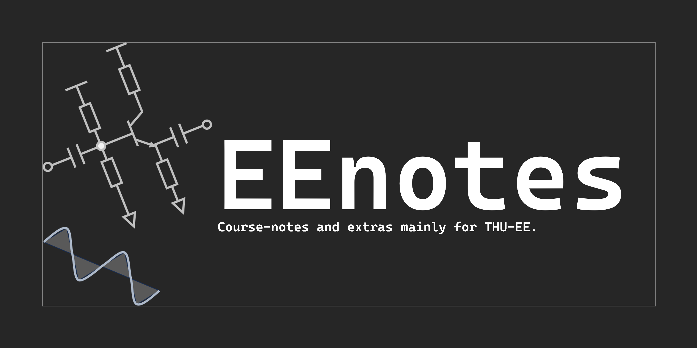

# EEnotes


面向清华大学电子系的学习笔记，按照“课程组 / 课程 / 章节”三级结构整理。


| 组 | 具体内容 |
| --- | --- |
| 数理基础组 | 线性代数(1)、线性代数(2)、大学物理（热学） |
| 物理-电磁组 | 电磁场与电磁波、量子与统计、固体物理 |
| 电路组 | 电子电路与系统基础、模拟电路原理、数字逻辑与处理器基础、微波与光波技术基础 |
| 信号组 | 信号与系统、数字信号处理、通信与网络、随机过程、统计信号处理 |
| 计算机组 | 程设基础、数据结构与算法、媒体与认知 |
| 科研与工具组 | Matlab高级编程与工程应用、高等模拟电路原理、模拟数字数据转换器、电源管理芯片、OrCAD使用笔记、Latex基础教程、办事指南 |

课程文档位于 `docs/`，其目录约定如下：

```text
docs/
├── xx组/
│   └── course-slug/
│       ├── 01-第一章.md
│       ├── 02-第二章.md
│       └── ...
├── assets/
└── index.md
```

## 在线查看
部署于 https://note.weitao-jiang.cn

## 本地部署

建议使用 Python 3.12，并确保本机已安装 `git`。本项目使用 Zensical，继续读取 `mkdocs.yml`，所需版本记录在 `requirements.txt`。

1. 创建并激活虚拟环境

```bash
python -m venv .venv
source .venv/bin/activate
```

2. 安装 Zensical 及所需依赖

```bash
pip install -r requirements.txt
```

3. 在项目根目录启动本地预览

```bash
zensical serve
```

默认访问地址为：

```text
http://127.0.0.1:8000
```

4. 如需生成静态站点文件，可执行

```bash
zensical build
python scripts/chatjwt_build.py
```

生成结果默认位于 `site/` 目录。

### 说明

- 配置文件为项目根目录下的 `mkdocs.yml`。
- 文档源文件位于 `docs/` 目录；新增内容时请继续使用“xx组 / 课程文件夹 / 章节 Markdown”结构。
- GitHub Actions 会先构建 Zensical，再生成 chatJWT 索引，最后部署。主题和模板的修改不再依赖手动提交 `site/`。

## 与主站同步 UI

笔记沿用主站的蓝色强调色、浅灰画布、白色内容区、字体和完整站点导航。课程树、页内目录、搜索、代码复制与公式仍由 Zensical 提供。

主站仓库位于相邻的 `homepage/` 时，运行：

```bash
python scripts/sync_homepage_ui.py
```

其他位置可以使用 `--homepage-dir /path/to/homepage`。脚本从主站提取 `--ui-*` 设计变量、公共导航 CSS 和导航结构，并把导航链接转换为主站的绝对地址。生成文件已提交到笔记仓库，部署时无需访问主站源码。

同步后执行 `zensical build` 和 `python scripts/chatjwt_build.py`。笔记阅读布局的适配位于 `docs/stylesheets/homepage-palette.css`，Zensical 页眉位于 `overrides/partials/header.html`，阅读工具栏位于 `overrides/partials/notes-toolbar.html`。`homepage-tokens.css` 是主站公共尺寸文件 `static/css/site-layout.css` 的原样副本，在页面样式之后加载；首页、资料等公开页面也使用同一份文件，统一字号、导航边距、容器宽度和页面起始位置。它与 `public-header.css`、`site-nav.html` 都通过同步脚本更新。

## chatJWT 小精灵

笔记页复用主页的 chatJWT 组件，DeepSeek Token、语气、自动概括和请求额度统一在主页 `/admin_chatjwt` 配置。浏览笔记时会主动概括，并可以继续提问。

每次构建后执行 `python scripts/chatjwt_build.py`，从导航中列出的已构建公开页面提取正文，生成 `site/chatjwt-index.json`，并移除旧聊天组件。部署工作流也会执行该步骤。未列入公开导航的文档不会进入索引。

部署笔记更新后，在主页 chatJWT 设置中点击“同步笔记知识”，即可更新 RAG；同步失败时保留已有索引。前端从主页加载组件，跨域接口只允许本站域名，Token 始终保留在主页后端。
